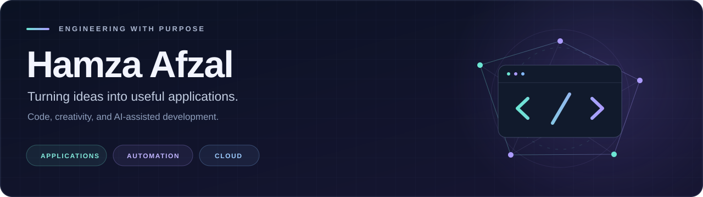

<h3 align="center">Software Engineer | AI-Assisted Application Development | Python & JavaScript | Web Development | Automation & Cloud Services</h3>

  

  <a href="https://github.com/ihamxaafzal?tab=repositories"><strong>Explore my projects</strong></a>
  &nbsp; · &nbsp;
  <a href="https://www.linkedin.com/in/iammhamzaafzal/"><strong>LinkedIn</strong></a>
  &nbsp; · &nbsp;
  <a href="mailto:mhamzaafzal785@gmail.com"><strong>Get in touch</strong></a>

## About me

I'm **Hamza Afzal**, a software engineer who builds desktop applications, web experiences, and automation tools that solve everyday problems.

I use **AI-assisted development** to explore ideas, develop features, and refine code. My focus is on understanding what I ship: useful functionality, clear interfaces, and setup instructions that make projects easier to run and maintain.

- **Application development:** Python tools and desktop utilities built around practical workflows.
- **Web development:** JavaScript, HTML, CSS, and WordPress experiences.
- **Automation:** reducing repetitive work with scripts, integrations, and purpose-built tools.
- **Cloud and delivery:** working with AWS, Google Cloud, virtual environments, and Agile workflows.

## Featured work

### [VoiceLoom](https://github.com/ihamxaafzal/VoiceLoom)

**A desktop workspace for turning scripts into narration.**

Browse 101 local and online voices, shape the delivery, generate narration, preview the waveform, and export audio. Includes local Kokoro synthesis, Microsoft Edge online voices, compatible voice blending, and Windows setup instructions.

  

**Built with:** Python · Tkinter · Kokoro · PyTorch · edge-tts · NumPy · SciPy

[View source and setup guide →](https://github.com/ihamxaafzal/VoiceLoom#readme)

| Project | What it does | Focus |
| --- | --- | --- |
| [OCR-ImageToText](https://github.com/ihamxaafzal/OCR-ImageToText) | Extracts text from images with Tesseract OCR, corrects spelling, and exports results to a spreadsheet. | Python · OCR · Document workflows |
| [TinyLock](https://github.com/ihamxaafzal/TinyLock) | A desktop and child-lock utility for Windows PCs. | Python · Windows utilities |

## Tools and skills

| Area | Technologies and practices |
| --- | --- |
| Languages | Python · JavaScript · HTML5 · CSS3 |
| Applications and automation | Tkinter · Desktop utilities · Workflow scripting · AI-assisted development |
| Web | WordPress · Interface development |
| Cloud and virtualization | AWS · Google Cloud · VMware |
| Project delivery | GitHub · Jira · Agile · Scrum |
| Supporting skills | Analytics and reporting · Content creation · Photoshop · Premiere Pro |

## How I approach a project

**Understand the problem → build a focused solution → test the workflow → document the setup.**

I care about tools people can actually use: straightforward interfaces, sensible defaults, and documentation that helps someone get started without guesswork.

## Let's connect

Interested in an application, a web project, or a workflow that could be automated?

- **GitHub:** [@ihamxaafzal](https://github.com/ihamxaafzal)
- **LinkedIn:** [M Hamza Afzal](https://www.linkedin.com/in/iammhamzaafzal/)
- **Email:** [mhamzaafzal785@gmail.com](mailto:mhamzaafzal785@gmail.com)

Building useful things, one project at a time.

