<p align="center">
  
</p>

<p align="center">
  <a href="https://github.com/ihamxaafzal">
    
  </a>
</p>

<p align="center">
  <a href="https://www.linkedin.com/in/iammhamzaafzal/" target="_blank">
    
  </a>
  <a href="mailto:mhamzaafzal785@gmail.com">
    
  </a>
  <a href="https://github.com/ihamxaafzal?tab=repositories">
    
  </a>
  
</p>

<p align="center">
  
</p>

## 👨‍💻 About Me

I'm **M Hamza Afzal**, a **Software Engineer** who turns practical ideas into polished, standalone software—spanning **AI-powered desktop applications**, **multi-agent orchestration**, **Windows system utilities**, and **web & cloud automation**.

I combine strong engineering fundamentals with **AI-assisted development** to iterate fast without compromising clarity, usability, or maintainability. Every project I ship is built for real end-users: clean UI, reliable local/cloud workflows, and frictionless setup.

<table>
  <tr>
    <td width="50%" valign="top">
      <strong>🤖 AI &amp; Multi-Agent Systems</strong><br/>
      Local AI voice synthesis (Kokoro, PyTorch), multi-agent mission command rooms, and intelligent workflow automation.
    </td>
    <td width="50%" valign="top">
      <strong>🖥️ Native Desktop Engineering</strong><br/>
      Production Windows utilities in <strong>Python</strong> &amp; <strong>C# / .NET</strong>—from hardware-level DDC/CI display control to OCR pipelines &amp; system security.
    </td>
  </tr>
  <tr>
    <td width="50%" valign="top">
      <strong>🌐 Web &amp; Browser Automation</strong><br/>
      Interactive JavaScript apps, WordPress experiences, and bulk browser profile &amp; extension automation tools.
    </td>
    <td width="50%" valign="top">
      <strong>☁️ Cloud &amp; Agile Delivery</strong><br/>
      Hands-on delivery across <strong>AWS</strong>, <strong>Google Cloud</strong>, VMware virtualization, GitHub CI/CD, Jira, and Agile/Scrum workflows.
    </td>
  </tr>
</table>

<p align="center">
  
</p>

## 🚀 Flagship Projects

### 🎙️ [VoiceLoom](https://github.com/ihamxaafzal/VoiceLoom) — *AI Desktop Text-to-Speech Studio*
> Turn scripts into studio-grade narration with **101 local & online voices**, compatible voice blending, interactive waveform playback, and **WAV / FLAC / MP3** export—packaged as a standalone Windows installer.

<p align="center">
  <a href="https://github.com/ihamxaafzal/VoiceLoom">
    
  </a>
</p>

<p align="center">
  
  
  
  
  
  
</p>

<br/>

### 🌐 [Chrome Bulk Profile Creator](https://github.com/ihamxaafzal/Chrome-Bulk-Profile-Creator) — *Windows Browser Automation Utility*
> Create and manage numbered Chrome profiles at scale with optional per-batch Chrome Web Store extension deployment—built to eliminate hours of repetitive manual setup.

<p align="center">
  <a href="https://github.com/ihamxaafzal/Chrome-Bulk-Profile-Creator">
    
  </a>
</p>

<br/>

### 🧩 More Production Projects

<table>
  <tr>
    <td width="50%" valign="top">
      <h4>🧠 <a href="https://github.com/ihamxaafzal/AgentDock">AgentDock</a></h4>
      <p>A local-first command room for <strong>Hermes Agent</strong> featuring animated multi-agent mission coordination, prompt extraction, research workflows, and optional AI image creation.</p>
      <code>JavaScript</code> · <code>Multi-Agent UI</code> · <code>AI Orchestration</code>
    </td>
    <td width="50%" valign="top">
      <h4>☀️ <a href="https://github.com/ihamxaafzal/AuraDim">AuraDim</a></h4>
      <p>Precision Windows monitor brightness, contrast &amp; eye-care warmth controller supporting external &amp; laptop displays via <strong>DDC/CI, WMI &amp; Universal Engine</strong>.</p>
      <code>C#</code> · <code>.NET</code> · <code>DDC/CI &amp; WMI</code> · <code>Hardware API</code>
    </td>
  </tr>
  <tr>
    <td width="50%" valign="top">
      <h4>📄 <a href="https://github.com/ihamxaafzal/OCR-ImageToText">OCR-ImageToText</a></h4>
      <p>Privacy-friendly Windows desktop OCR app for batch image-to-text extraction with Tesseract language/layout tuning, enhanced OCR pass comparison, and <strong>TXT / CSV / XLSX</strong> export.</p>
      <code>Python</code> · <code>Tesseract OCR</code> · <code>Batch Pipelines</code>
    </td>
    <td width="50%" valign="top">
      <h4>🔒 <a href="https://github.com/ihamxaafzal/TinyLock">TinyLock</a></h4>
      <p>Lightweight, full-screen Windows desktop privacy screen with a refined UI, password protection, live clock, and native Windows secure-lock integration.</p>
      <code>C#</code> · <code>WinForms</code> · <code>Windows Security</code>
    </td>
  </tr>
</table>

<p align="center">
  
</p>

## 🛠️ Tech Stack & Engineering Toolkit

**Languages & Core**

<p>
  
  
  
  
  
</p>

**AI, Desktop & Web Frameworks**

<p>
  
  
  
  
  
  
</p>

**Cloud, Virtualization & Delivery**

<p>
  
  
  
  
  
  
</p>

<p align="center">
  
</p>

## 📊 GitHub Analytics & Contribution Activity

<p align="center">
  
  &nbsp;
  
</p>

<p align="center">
  
</p>

<p align="center">
  <picture>
    <source media="(prefers-color-scheme: dark)" srcset="https://raw.githubusercontent.com/ihamxaafzal/ihamxaafzal/output/github-contribution-grid-snake-dark.svg" />
    <source media="(prefers-color-scheme: light)" srcset="https://raw.githubusercontent.com/ihamxaafzal/ihamxaafzal/output/github-contribution-grid-snake.svg" />
    
  </picture>
</p>

<p align="center">
  
</p>

## ⚙️ How I Engineer & Ship

```text
01. Understand the Bottleneck  →  Identify the real workflow friction before writing code
02. Architect & Prototype Fast →  Leverage AI-assisted workflows with clean, readable structure
03. Polish & Stress-Test       →  Sensible defaults, responsive UX, and edge-case handling
04. Document for Zero-Friction →  Clear READMEs, visual demos, and reproducible setup guides
```

## 🤝 Let's Connect — Open to Software Engineering Roles

Looking for a **Software Engineer**, **AI Application Developer**, or **Desktop / Automation Engineer** who ships real, user-ready products? I'd love to chat!

<p align="center">
  <a href="https://www.linkedin.com/in/iammhamzaafzal/" target="_blank">
    
  </a>
  <a href="mailto:mhamzaafzal785@gmail.com">
    
  </a>
  <a href="https://github.com/ihamxaafzal">
    
  </a>
</p>

<p align="center">
  
</p>
